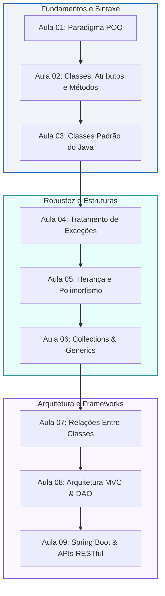

# ☕ Back-End Java Fundamentals

[](https://www.oracle.com/java/)
[](https://spring.io/projects/spring-boot)
[](https://git-scm.com/)
[](LICENSE)

> Repositório completo de estudos, exemplos práticos e projetos da disciplina de **Desenvolvimento Back-End em Java**, estruturado de forma didática, progressiva e alinhada às melhores práticas de engenharia de software e padrões de mercado.
>
> 🌐 **Ementa de Referência:** [Notion - Desenvolvimento Back-End JAVA](https://cainaantunes.notion.site/Desenvolvimento-Back-End-JAVA-3aea95f36a1d4097b6e680c57aed0403)

---

## 🎯 Sobre o Repositório

O objetivo deste repositório é consolidar a jornada de aprendizado em desenvolvimento back-end com Java, partindo dos fundamentos filosóficos da Programação Orientada a Objetos (POO) até a construção de arquiteturas modernas em camadas com o framework **Spring Boot**.

Cada módulo do curso conta com uma pasta individualizada contendo exatamente:
1. 📘 **README.md:** Um guia teórico aprofundado ("resumão"), didático e ricamente documentado com diagramas conceituais.
2. ☕ **Código Java Explicativo (`.java`):** Implementação prática, limpa e comentada linha a linha, pronta para compilação e execução.
3. 📝 **Caderno de Exercícios Práticos (`exercicios-praticos.md`):** Questões conceituais, desafios de código e gabaritos com soluções detalhadas.

---

## 🗺️ Mapa da Jornada de Aprendizado



---

## 📚 Índice Completo das Aulas

Navegue diretamente pelos módulos de estudo utilizando os links abaixo:

| Aula | Tema Central | Resumo Teórico | Código Comentado | Exercícios & Desafios |
|:---:|---|:---:|:---:|:---:|
| **01** | **Paradigma POO & Pilares** | [📘 Resumo Aula 01](aula-01-paradigma-poo/README.md) | [☕ ExemploAula01.java](aula-01-paradigma-poo/ExemploAula01.java) | [📝 Exercícios 01](aula-01-paradigma-poo/exercicios-praticos.md) |
| **02** | **Classes, Construtores & Encapsulamento** | [📘 Resumo Aula 02](aula-02-classes-atributos-metodos/README.md) | [☕ ExemploAula02.java](aula-02-classes-atributos-metodos/ExemploAula02.java) | [📝 Exercícios 02](aula-02-classes-atributos-metodos/exercicios-praticos.md) |
| **03** | **Classes Utilitárias: String, Math, Random & GUI** | [📘 Resumo Aula 03](aula-03-classes-java/README.md) | [☕ ExemploAula03.java](aula-03-classes-java/ExemploAula03.java) | [📝 Exercícios 03](aula-03-classes-java/exercicios-praticos.md) |
| **04** | **Tratamento Defensivo de Exceções** | [📘 Resumo Aula 04](aula-04-tratamento-de-excecoes/README.md) | [☕ ExemploAula04.java](aula-04-tratamento-de-excecoes/ExemploAula04.java) | [📝 Exercícios 04](aula-04-tratamento-de-excecoes/exercicios-praticos.md) |
| **05** | **Herança, Classes Abstratas & Polimorfismo** | [📘 Resumo Aula 05](aula-05-heranca-e-polimorfismo/README.md) | [☕ ExemploAula05.java](aula-05-heranca-e-polimorfismo/ExemploAula05.java) | [📝 Exercícios 05](aula-05-heranca-e-polimorfismo/exercicios-praticos.md) |
| **06** | **Java Collections Framework & Generics** | [📘 Resumo Aula 06](aula-06-collections-e-listas/README.md) | [☕ ExemploAula06.java](aula-06-collections-e-listas/ExemploAula06.java) | [📝 Exercícios 06](aula-06-collections-e-listas/exercicios-praticos.md) |
| **07** | **Relacionamentos, UML & Cardinalidade** | [📘 Resumo Aula 07](aula-07-relacionamento-entre-classes/README.md) | [☕ ExemploAula07.java](aula-07-relacionamento-entre-classes/ExemploAula07.java) | [📝 Exercícios 07](aula-07-relacionamento-entre-classes/exercicios-praticos.md) |
| **08** | **Padrão MVC, DAO & Persistência** | [📘 Resumo Aula 08](aula-08-arquitetura-mvc/README.md) | [☕ ExemploAula08.java](aula-08-arquitetura-mvc/ExemploAula08.java) | [📝 Exercícios 08](aula-08-arquitetura-mvc/exercicios-praticos.md) |
| **09** | **Spring Boot, IoC, DI & APIs REST** | [📘 Resumo Aula 09](aula-09-spring-e-springboot/README.md) | [☕ ExemploAula09.java](aula-09-spring-e-springboot/ExemploAula09.java) | [📝 Exercícios 09](aula-09-spring-e-springboot/exercicios-praticos.md) |

---

## 🛠️ Projetos Práticos Integrados

Além das aulas teóricas e exercícios, o repositório conta com projetos aplicados desenvolvidos durante o semestre:

| Projeto | Tecnologia / Conceito | Descrição | Acesso |
|---|---|---|:---:|
| **Simulador de Luta** | POO, Random, Game Loop | Jogo em modo texto com combates medievais em turnos e cálculo dinâmico de dano. | [Visualizar Projeto](projetos-praticos/simulador-luta/README.md) |
| **Gerenciador de Arquivos** | Encapsulamento, Pacotes, Swing | Sistema de arquivos virtual em memória com cálculo dinâmico de bits e diálogo gráfico. | [Visualizar Projeto](projetos-praticos/gerenciador-arquivos/README.md) |
| **Mini-Projeto ScreenSaver** | Herança, Polimorfismo, Swing 2D | Protetor de tela animado em 60 FPS com formas polimórficas e física de colisão. | [Visualizar Projeto](projetos-praticos/screensaver/README.md) |

---

## 💻 Como Compilar e Executar os Exemplos

Todos os códigos foram projetados para rodar sem dependências externas adicionais, utilizando apenas o JDK nativo (Java 17 ou superior recomendado).

### 1. Clonar o repositório
```bash
git clone https://github.com/Arthur-2612/back-end-fundamentals.git
cd back-end-fundamentals
```

### 2. Compilar e executar qualquer aula
Exemplo com a **Aula 05 (Herança e Polimorfismo)**:
```bash
cd aula-05-heranca-e-polimorfismo
javac ExemploAula05.java
java ExemploAula05
```

Exemplo com o **Simulador de Combate**:
```bash
cd projetos-praticos/simulador-luta
javac Personagem.java Main.java
java Main
```

---

## 📌 Padrão de Commits Adotado

O repositório adota a convenção internacional de [Conventional Commits](https://www.conventionalcommits.org/pt-br/v1.0.0/):

- `feat:` Inclusão de novas implementações de código ou projetos.
- `docs:` Criação ou enriquecimento de documentações, resumos de aula e listas de exercícios.
- `refactor:` Melhorias estruturais em código existente sem alterar comportamento funcional.
- `chore:` Configurações auxiliares, ajustes de `.gitignore` ou manutenção de repositório.

---

## 👨‍💻 Autor

Desenvolvido por **Arthur Silva**  
Repositório mantido como portfólio profissional de estudos em desenvolvimento back-end e engenharia de software Java.
