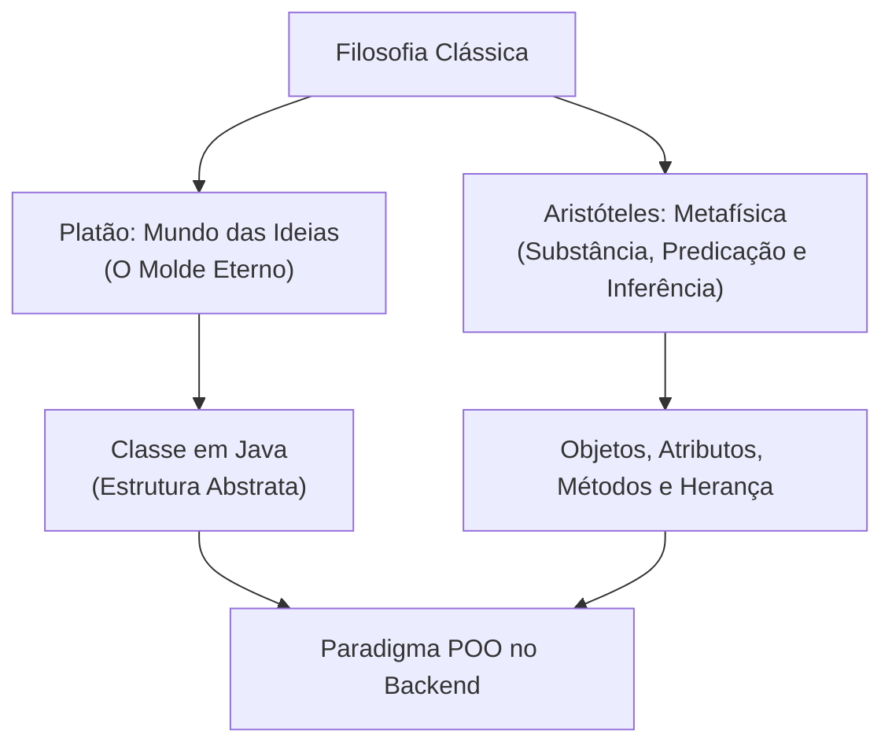
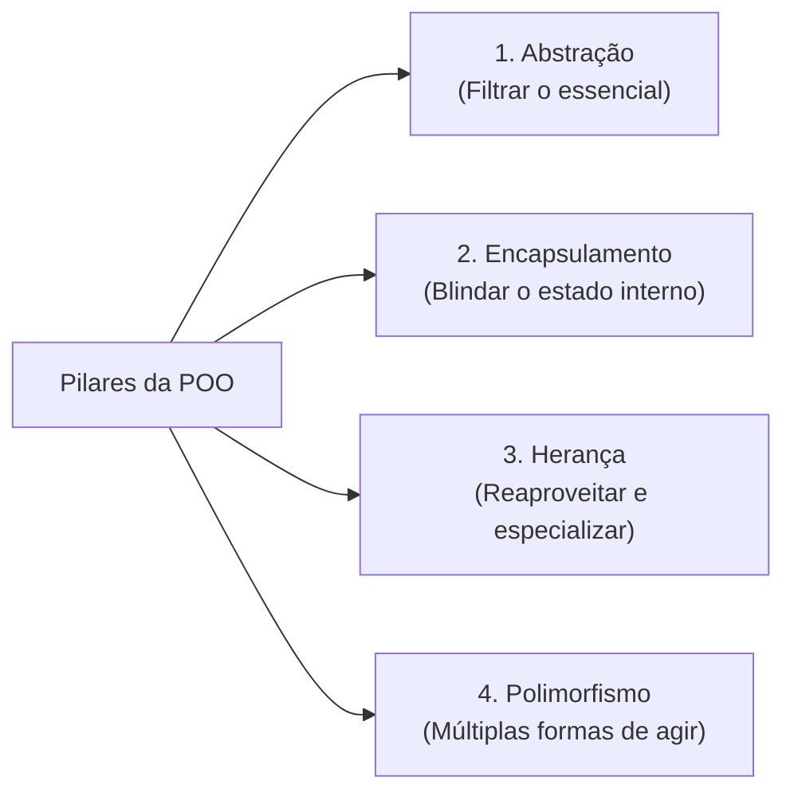
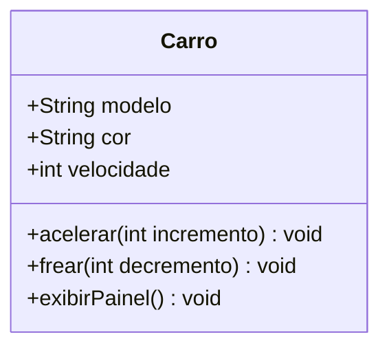

# 🏛️ Aula 01: O Paradigma da Programação Orientada a Objetos (POO)

> *"Antes de ser código em Java, a Orientação a Objetos é uma forma de pensar e modelar a realidade."*

---

## 🎯 Objetivos de Aprendizagem
- Compreender a origem conceitual e as **bases filosóficas** da POO (Platão e Aristóteles).
- Diferenciar com clareza absoluta o que é uma **Classe** (ideia/molde) e o que é um **Objeto** (instância/concreto).
- Entender os **4 Pilares Fundamentais da POO**: Abstração, Encapsulamento, Herança e Polimorfismo.
- Aprender a ler e rascunhar diagramas simples de classes em **UML** (Unified Modeling Language).

---

## 🧠 1. As Bases Filosóficas da POO

Frequentemente a programação orientada a objetos é ensinada apenas como sintaxe (`class`, `new`, `public void`). No entanto, a POO resolveu um problema que pensadores da Grécia Antiga já discutiam há mais de 2.400 anos: **como os seres humanos categorizam, compreendem e representam a realidade?**



### 🏛️ Platão e o Mundo das Ideias
Platão propôs uma divisão fundamental na realidade:
1. **Mundo Sensível (A Caverna):** É o mundo físico onde vivemos. Tudo nele é transitório, imperfeito, perecível. Um carro específico na rua pode amassar, enferrujar ou ser desmontado. Ele é apenas uma cópia imperfeita.
2. **Mundo das Ideias (ou Inteligível):** É acessível apenas pela razão. Lá reside a ideia perfeita, eterna e universal de "Carro". Mesmo que todos os carros físicos deixem de existir, o conceito de carro permanece intacto na mente.

> 💡 **Conexão com a POO:**  
> A **Classe** em Java é como o *Mundo das Ideias* de Platão: ela define o conceito imutável.  
> O **Objeto** é como o *Mundo Sensível*: é a instância viva na memória RAM que nasce (`new`), opera e um dia deixa de existir (coletado pelo *Garbage Collector*).

### 🏛️ Aristóteles e a Metafísica (Substância e Predicação)
Aristóteles, discípulo de Platão, acreditava que a forma não estava em outro mundo, mas sim presente em cada ser individual:
- **Substância (O que o ser é):** Composta por **Matéria** (o meio físico) e **Forma** (o desenho/estrutura).
- **Predicação:** Para descrever qualquer ser, nós o predicamos com:
  - **Características (Atributos):** cor, peso, velocidade, saldo, nome.
  - **Ações/Comportamentos (Métodos):** acelerar, frear, transferir, latir.
- **Inferência Lógica (Silogismo):** Se "Todo animal é mortal" e "O homem é um animal", logo "O homem é mortal". Na POO, isso é exatamente a **Herança**: se `Animal` respira, e `Cachorro` herda de `Animal`, `Cachorro` automaticamente sabe respirar!

---

## 📦 2. O que é uma Classe vs. O que é um Objeto?

| Conceito | O que é? | Exemplo no Mundo Real | Exemplo em Java | Ocupa RAM para dados? |
| :--- | :--- | :--- | :--- | :--- |
| **Classe** | Molde, planta baixa, especificação abstrata | A planta arquitetônica de uma casa | `public class Carro { ... }` | Não (apenas metadados de código) |
| **Objeto** | A instância física, concreta, viva | A casa construída com tijolos no terreno | `Carro meuFusca = new Carro();` | Sim (espaço alocado na memória Heap) |

```java
// A CLASSE (O Molde / Conceito Platônico)
public class Celular {
    // Atributos (Características / Predicações de Aristóteles)
    String marca;
    String modelo;
    int bateria;

    // Métodos (Comportamentos)
    void ligar() {
        System.out.println("O celular " + modelo + " está inicializando...");
    }
}
```

```java
// OS OBJETOS (As Instâncias do Mundo Sensível)
Celular celularArthur = new Celular();
celularArthur.marca = "Apple";
celularArthur.modelo = "iPhone 15";
celularArthur.bateria = 85;

Celular celularMaria = new Celular();
celularMaria.marca = "Samsung";
celularMaria.modelo = "Galaxy S24";
celularMaria.bateria = 92;
```
> [!NOTE]  
> Note que a classe `Celular` foi escrita **uma única vez**, mas criamos **dois objetos distintos** na memória, cada um com seus próprios valores!

---

## 🏛️ 3. Os 4 Pilares da POO

Os quatro pilares formam o alicerce de qualquer arquitetura moderna de software backend:



### 1. Abstração
- **Conceito:** Capacidade de isolar os aspectos essenciais de um problema e descartar detalhes irrelevantes para o contexto do software.
- **Exemplo:** Em um sistema bancário, para a classe `Cliente` importa o CPF, nome, renda e saldo. A cor do cabelo, altura ou time de futebol do cliente são detalhes irrelevantes e devem ser ignorados.

### 2. Encapsulamento
- **Conceito:** Ocultar a complexidade interna e proteger os dados contra alterações indevidas ou estados inconsistentes.
- **Exemplo:** Uma conta bancária não deve permitir que qualquer um altere o atributo `saldo = -999999`. O saldo deve ser privado (`private`), e alterações só devem acontecer por métodos controlados como `depositar()` e `sacar()`.

### 3. Herança
- **Conceito:** Mecanismo pelo qual uma classe filha (subclasse) herda características e comportamentos de uma classe mãe (superclasse), promovendo o reúso de código e criando hierarquias semânticas.
- **Exemplo:** `ContaPoupanca` e `ContaCorrente` herdam de `ContaBancaria`.

### 4. Polimorfismo
- **Conceito:** "Muitas formas". Permite que objetos de classes diferentes respondam à mesma chamada de método, cada um com sua implementação particular.
- **Exemplo:** Ao chamar `emitirSom()`, um objeto `Cachorro` late e um `Gato` mia. O chamador não precisa saber a raça exata, apenas sabe que animais emitem som.

---

## 📐 4. Introdução a Diagramas de Classe (UML)

Na engenharia de software, antes de codificar, usamos diagramas UML para planejar o sistema:



- O sinal `+` indica visibilidade pública (*public*).
- O sinal `-` indica visibilidade privada (*private*).
- O sinal `#` indica visibilidade protegida (*protected*).

---

## 💡 Dicas de Ouro para Entrevistas e Provas
1. **O que é POO?** É um paradigma que modela sistemas a partir de entidades (objetos) que encapsulam estado (atributos) e comportamento (métodos).
2. **Qual a diferença entre Classe e Objeto?** A classe é a descrição conceitual/molde estático; o objeto é a instância viva com dados alocados na memória heap.
3. **Por que usar POO no Backend?** Porque simplifica a manutenção de sistemas corporativos complexos, facilita a criação de camadas (Controller, Service, Repository) e permite reaproveitar regras de negócio com facilidade.

