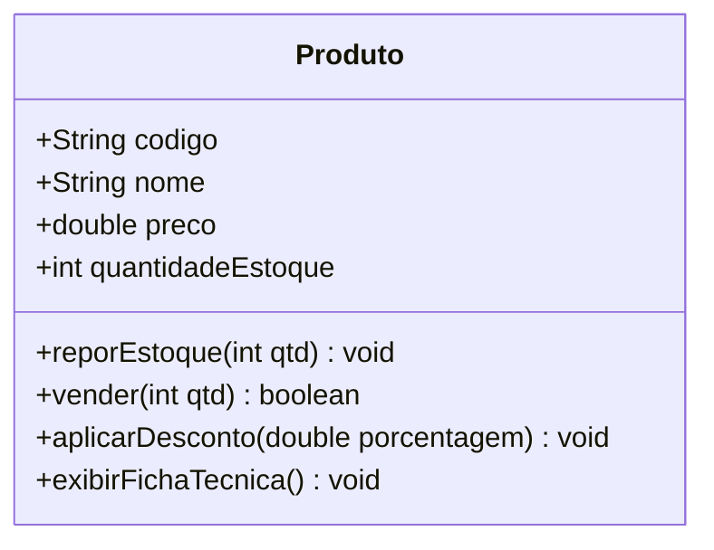

# 📝 Caderno de Exercícios & Desafios: Aula 01 (POO)

Este material foi preparado para consolidar o entendimento prático e teórico sobre o **Paradigma de Programação Orientada a Objetos**, abstração e modelagem de entidades.

---

## 🎯 Exercício 01: Abstração e Modelagem de um `Produto`

### Cenário
Você foi contratado para iniciar o backend de uma loja virtual (e-commerce). A primeira entidade que o sistema precisa gerenciar é o **Produto**.

### Requisitos:
1. Identifique os atributos essenciais para um produto (descarte características irrelevantes para o negócio).
2. Crie métodos para:
   - Adicionar unidades ao estoque (`reporEstoque`).
   - Baixar unidades do estoque após uma venda (`vender`), garantindo que não seja possível vender se a quantidade solicitada for maior que o estoque atual.
   - Aplicar uma porcentagem de desconto no preço.
3. Desenhe o diagrama UML de classes correspondente.

### 📐 Diagrama de Classes Proposto (UML)


### 💻 Resolução Sugerida em Java:
```java
public class Produto {
    String codigo;
    String nome;
    double preco;
    int quantidadeEstoque;

    public void reporEstoque(int qtd) {
        if (qtd > 0) {
            quantidadeEstoque += qtd;
            System.out.println("Estoque abastecido. Total atual: " + quantidadeEstoque);
        }
    }

    public boolean vender(int qtd) {
        if (qtd > 0 && qtd <= quantidadeEstoque) {
            quantidadeEstoque -= qtd;
            System.out.println("Venda de " + qtd + "x " + nome + " realizada com sucesso!");
            return true;
        } else {
            System.out.println("Estoque insuficiente para concluir a venda.");
            return false;
        }
    }

    public void aplicarDesconto(double porcentagem) {
        if (porcentagem > 0 && porcentagem <= 100) {
            preco -= preco * (porcentagem / 100.0);
            System.out.println("Novo preço com desconto: R$ " + preco);
        }
    }
}
```

---

## 🚀 Desafio Prático: O Sistema de Alunos e Médias

### Enunciado
Modele uma classe `Aluno` que possua:
- Atributos: `matricula`, `nome`, `nota1`, `nota2`.
- Métodos:
  - `calcularMedia()`: retorna a média aritmética simples das duas notas.
  - `verificarAprovacao()`: retorna `true` se a média for maior ou igual a 7.0, e `false` caso contrário.
  - `exibirBoletim()`: imprime no terminal todos os dados formatados.

---

## 🧠 Quiz de Fixação Rápida

1. **Segundo a visão platônica adaptada à programação, o que é a `Classe`?**
   - (A) Uma variável que armazena números inteiros.
   - (B) A ideia imutável, o molde perfeito que descreve a estrutura dos objetos. *(Correta)*
   - (C) Um erro de compilação.

2. **Qual é a principal responsabilidade do pilar da `Abstração`?**
   - (A) Copiar e colar código em múltiplos arquivos.
   - (B) Isolar os dados e métodos essenciais para o contexto do sistema, filtrando o que não importa. *(Correta)*
   - (C) Proteger a senha do banco de dados em um cofre físico.

3. **Se criarmos `Carro c1 = new Carro();` e `Carro c2 = new Carro();`, o que acontece na memória?**
   - (A) Ambos compartilham exatamente o mesmo endereço de memória e as mesmas variáveis.
   - (B) Duas instâncias independentes são criadas no Heap, cada uma com seu próprio estado. *(Correta)*
   - (C) O compilador dá erro por duplicidade de variáveis.
