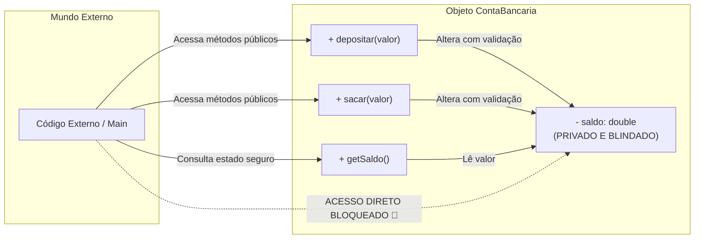
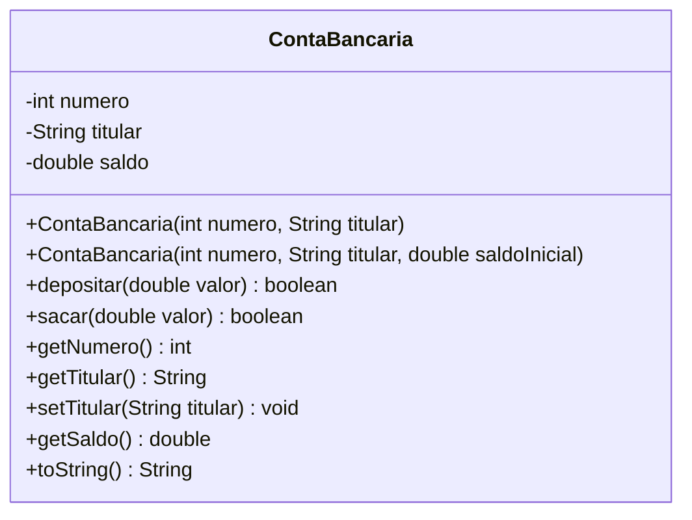

# 🧱 Aula 02: Estrutura de uma Classe Java, Encapsulamento e Métodos Padrões

> *"Uma classe bem construída não expõe suas entranhas: ela oferece uma interface confiável e protege seu estado interno contra abusos."*

---

## 🎯 Objetivos de Aprendizagem
- Dominar as **convenções oficiais de código Java** (*CamelCase* e boas práticas).
- Entender os **modificadores de acesso** (`private`, `public`, `protected`, *package-default*).
- Implementar o princípio do **Encapsulamento** com precisão usando *Getters* e *Setters*.
- Aprender o papel do **Método Construtor** e como aplicar a **Sobrecarga** (*Overloading*).
- Customizar a representação textual do objeto sobrescrevendo o método **`toString()`** com a anotação `@Override`.

---

## 📝 1. Anatomia e Convenções de Nomenclatura

Em Java, a convenção não é apenas estética: ela facilita a leitura imediata em times de desenvolvimento:

| Elemento | Padrão Utilizado | Exemplo Correto | Exemplo Incorreto |
| :--- | :--- | :--- | :--- |
| **Classes** | `UpperCamelCase` (PascalCase) | `ContaBancaria`, `UsuarioService` | `contaBancaria`, `conta_bancaria` |
| **Atributos** | `lowerCamelCase` | `saldoAtual`, `numeroAgencia` | `SaldoAtual`, `saldo_atual` |
| **Métodos** | `lowerCamelCase` (Verbo) | `calcularJuros()`, `depositar()` | `CalcularJuros()`, `calculo()` |
| **Parâmetros** | `lowerCamelCase` | `(double valorDeposito)` | `(double Valor)` |
| **Constantes** | `UPPER_SNAKE_CASE` | `TAXA_TRANSACAO_PADRAO` | `TaxaTransacao` |

---

## 🔒 2. Encapsulamento & Modificadores de Acesso

Encapsular é criar uma **cápsula** ao redor dos dados. Quem está de fora não deve mexer diretamente no motor do carro; quem está de fora usa o volante e os pedais.



### Tabela de Visibilidade dos Modificadores:
1. `private`: Acessível **apenas dentro da própria classe**. Atributos devem ser quase sempre `private`!
2. `public`: Acessível de **qualquer lugar do projeto**. Métodos de serviço e operações públicas.
3. `protected`: Acessível dentro do **mesmo pacote** e por **subclasses** (herança).
4. *(Sem modificador / Default)*: Acessível apenas por classes que estão **no mesmo pacote**.

---

## ⚙️ 3. O Método Construtor

O construtor é um bloco de código especial invocado no exato momento em que o objeto é instanciado com `new`.
- **Regras obrigatórias:**
  1. Deve possuir **exatamente o mesmo nome da classe** (incluindo maiúsculas).
  2. **Não possui tipo de retorno** (nem mesmo `void`).
- **Função principal:** Garantir que o objeto nasça em um estado válido e consistente.

```java
public class ContaBancaria {
    private int numero;
    private String titular;
    private double saldo;

    // CONSTRUTOR PADRÃO / CUSTOMIZADO
    public ContaBancaria(int numero, String titular) {
        this.numero = numero;
        this.titular = titular;
        this.saldo = 0.0; // Todo cliente começa com saldo zerado
    }
}
```

> 🔑 **A palavra-chave `this`:**  
> Usamos `this.numero = numero;` para diferenciar o **atributo da classe** (`this.numero`) do **parâmetro recebido pelo método** (`numero`).

---

## 🔄 4. Sobrecarga de Métodos e Construtores (Overloading)

A sobrecarga ocorre quando temos **dois ou mais métodos com o mesmo nome na mesma classe, mas com listas de parâmetros diferentes** (quantidade ou tipos distintos).

```java
// Construtor 1: apenas dados básicos
public ContaBancaria(int numero, String titular) {
    this(numero, titular, 0.0); // Invoca o Construtor 2 via this()!
}

// Construtor 2: dados básicos + depósito inicial
public ContaBancaria(int numero, String titular, double saldoInicial) {
    this.numero = numero;
    this.titular = titular;
    this.saldo = saldoInicial;
}
```

---

## 📜 5. O Método `toString()` e `@Override`

Todo objeto em Java herda implicitamente da classe ancestral universal `java.lang.Object`.
Se imprimirmos um objeto sem sobrescrever `toString()`, o Java exibirá algo inútil para humanos: `ContaBancaria@682a0b29` (nome da classe + hashcode na memória).

Ao sobrescrever `toString()` com `@Override`, definimos exatamente como o objeto deve se apresentar em formato de texto amigável:

```java
@Override
public String toString() {
    return "ContaBancaria [Número: " + numero + ", Titular: " + titular + ", Saldo: R$ " + saldo + "]";
}
```

---

## 📊 6. Diagrama da Classe `ContaBancaria` (UML)


