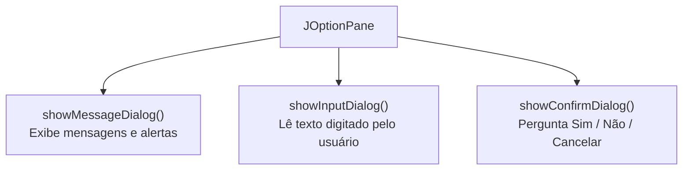

# 🧰 Aula 03: Classes Java, Bibliotecas Padrão e Utilitários Estáticos

> *"Dominar a biblioteca padrão do Java é a diferença entre reinventar a roda com bugs ou escrever sistemas elegantes e eficientes em poucas linhas."*

---

## 🎯 Objetivos de Aprendizagem
- Entender a organização modular do Java através de **Pacotes** (`package` e `import`).
- Compreender a fundo a classe **`String`**, sua **imutabilidade** e métodos essenciais de manipulação textual.
- Utilizar a classe **`Random`** para geração de números pseudoaleatórios e entender o conceito de **seed**.
- Aprender a criar caixas de diálogo gráficas amigáveis com **`JOptionPane`**.
- Dominar o modificador **`static`** e o uso de classes utilitárias como a **`Math`**.

---

## 📦 1. Pacotes e Importações (`package` & `import`)

Em Java, pacotes agrupam classes logicamente semelhantes (como diretórios no sistema de arquivos):
- `java.lang.*`: Pacote fundamental contendo `String`, `System`, `Math`, `Integer`. **É importado automaticamente em todo arquivo Java!**
- `java.util.*`: Utilitários gerais, como `Random`, `Scanner`, coleções (`List`, `Map`).
- `javax.swing.*`: Componentes de interface gráfica desktop simples (`JOptionPane`).

```java
import java.util.Random;       // Importa especificamente a classe Random
import javax.swing.JOptionPane; // Importa o diálogo gráfico
```

---

## 🔤 2. A Classe `String` e o Segredo da Imutabilidade

Diferente de `int` ou `boolean`, **`String` não é um tipo primitivo: é um objeto da classe `java.lang.String`!**

### O que significa ser Imutável?
Uma vez criado um objeto `String` na memória, seus caracteres **nunca podem ser alterados**. Qualquer método que pareça modificar a string (como `toUpperCase()` ou `replace()`) na verdade **cria e devolve um novo objeto**!

```java
String texto = "Backend";
texto.toUpperCase(); // ⚠️ ATENÇÃO: NÃO ALTERA A VARIÁVEL ORIGINAL!

System.out.println(texto); // Continua imprimindo "Backend"

// Forma correta: reatribuir a referência
texto = texto.toUpperCase(); // Agora aponta para a nova String "BACKEND"
```

### Métodos mais Importantes da Classe `String`:
| Método | O que faz? | Exemplo | Resultado |
| :--- | :--- | :--- | :--- |
| `length()` | Retorna a quantidade de caracteres | `"Java".length()` | `4` |
| `toUpperCase()` | Converte tudo para maiúsculas | `"olá".toUpperCase()` | `"OLÁ"` |
| `toLowerCase()` | Converte tudo para minúsculas | `"JAVA".toLowerCase()` | `"java"` |
| `trim()` | Remove espaços no início e no fim | `"  texto  ".trim()` | `"texto"` |
| `substring(inicio, fim)` | Recorta um trecho do texto | `"Backend".substring(0, 4)` | `"Back"` |
| `contains("termo")` | Verifica se contém o trecho | `"Spring Boot".contains("Boot")` | `true` |
| `replace(antigo, novo)` | Substitui caracteres | `"banana".replace("a", "o")` | `"bonono"` |

> ⚠️ **CUIDADO VITAL: Comparação de Strings (`equals` vs `==`)**  
> Em Java, `==` compara o **endereço de memória** dos objetos, e NÃO o texto!  
> Para comparar o conteúdo de Strings, SEMPRE use o método `.equals()` ou `.equalsIgnoreCase()`:
> ```java
> if (nome1.equals(nome2)) { /* CORRETO */ }
> ```

---

## 🎲 3. A Classe `Random` (Números Pseudoaleatórios)

Localizada em `java.util.Random`, permite gerar valores numéricos ou booleanos aleatórios:

```java
Random r = new Random();

int dado6 = r.nextInt(6) + 1;       // Gera número entre 1 e 6
double porcentagem = r.nextDouble(); // Gera valor decimal entre 0.0 e 1.0
boolean moeda = r.nextBoolean();     // Gera true ou false
```

### O que é a Semente (*Seed*)?
Computadores não geram aleatoriedade verdadeira: eles usam algoritmos matemáticos baseados em uma **semente inicial**.
- Se você definir uma semente fixa (`new Random(42)` ou `r.setSeed(42)`), **a sequência de números sorteados será rigorosamente a mesma toda vez que o programa rodar**! Isso é vital para testes unitários automatizados e simulações científicas.

---

## 🖼️ 4. A Classe `JOptionPane` (Interação Gráfica Simples)

Permite interagir com o usuário via janelas pop-up sem precisar de terminal:



```java
// 1. Entrada de texto
String nome = JOptionPane.showInputDialog("Digite seu nome:");

// 2. Mensagem na tela
JOptionPane.showMessageDialog(null, "Bem-vindo ao Backend, " + nome + "!", "Aviso", JOptionPane.INFORMATION_MESSAGE);
```

---

## ⚡ 5. Classes e Métodos Estáticos (`static` & `Math`)

Quando um membro é declarado como `static`:
- Ele **pertence à classe em si**, e não a um objeto individual.
- Não é necessário dar `new` para usá-lo!

### A Classe `java.lang.Math`:
```java
double potencia = Math.pow(2, 3); // 2 elevado a 3 = 8.0
double raiz = Math.sqrt(49);      // Raiz quadrada de 49 = 7.0
int maior = Math.max(10, 25);     // 25
double pi = Math.PI;              // Constante 3.14159...
```
