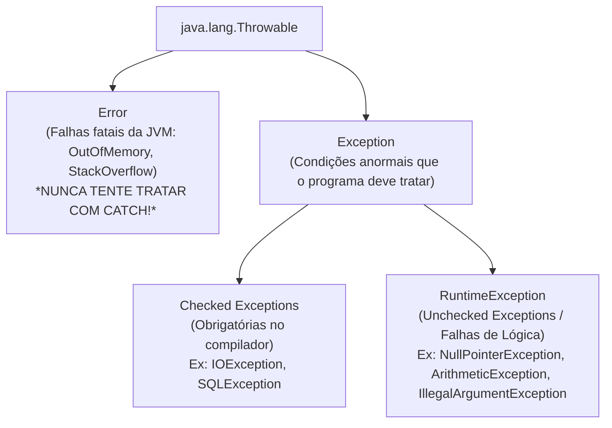

# ⚠️ Aula 04: Tratamento de Exceções (Exceptions) e Resiliência no Back-End

> *"Um software amador quebra silenciosamente ou trava a aplicação inteira ao encontrar um erro; um software profissional antecipa falhas, trata exceções com elegância e mantém o sistema de pé."*

---

## 🎯 Objetivos de Aprendizagem
- Entender a árvore genealógica de exceções no Java (`Throwable`, `Error`, `Exception`, `RuntimeException`).
- Diferenciar com clareza **Checked Exceptions** (checadas pelo compilador) de **Unchecked Exceptions** (tempo de execução).
- Dominar o fluxo de tratamento com **`try`**, **`catch`** e **`finally`**.
- Saber a diferença fundamental entre **`throw`** (ação de disparar o erro) e **`throws`** (declaração formal na assinatura do método).
- Criar **Exceções Customizadas** de negócio para sistemas corporativos.

---

## 🌳 1. A Hierarquia de Classes de Exceção em Java

Em Java, todo erro ou anomalia é um objeto descendente da classe `Throwable`:



### Checked vs. Unchecked: Qual a diferença crucial?
1. **Checked Exceptions (Checadas):** O compilador verifica na hora! Se o seu método pode disparar uma checked exception, você é **obrigado** a tratá-la em um bloco `try/catch` ou declará-la com `throws` na assinatura. Exemplo: leitura de arquivos que podem não existir no HD.
2. **Unchecked Exceptions (Não Checadas / Runtime):** Ocorrem em tempo de execução, geralmente decorrentes de bugs na lógica do programador (divisão por zero, ponteiro nulo, índice fora do array). Não é obrigatório declarar na assinatura.

---

## 🛡️ 2. A Estrutura `try`, `catch` e `finally`

```java
try {
    // 1. Bloco de código protegido (onde algo pode dar errado)
    int resultado = 10 / 0; 
} catch (ArithmeticException e) {
    // 2. Bloco executado apenas se a exceção informada acontecer
    System.out.println("Erro: Não é possível dividir por zero!");
    System.out.println("Detalhe técnico: " + e.getMessage());
} finally {
    // 3. Bloco GARANTIDO: executa SEMPRE (havendo erro ou não)!
    // Perfeito para fechar conexões de banco de dados e arquivos abertos.
    System.out.println("Finalizando limpeza de recursos...");
}
```

---

## ⚡ 3. `throw` vs. `throws`: Nunca mais confunda!

| Palavra-Chave | Tipo de Elemento | O que faz? | Exemplo |
| :--- | :--- | :--- | :--- |
| **`throw`** | Comando executável | **Dispara/atira** ativamente uma nova exceção na pilha de execução | `throw new IllegalArgumentException("Valor negativo!");` |
| **`throws`** | Modificador de assinatura | **Avisa** a quem for chamar o método que ele tem potencial de lançar aquele erro | `public void lerArquivo() throws IOException { ... }` |

---

## 🎯 4. Criando Exceções Personalizadas (Custom Exceptions)

Em aplicações profissionais de backend, é péssima prática lançar apenas `Exception` genérica. Criamos exceções com nomes que representem o domínio do negócio:

```java
// Criando uma exceção de negócio unchecked
public class SaldoInsuficienteException extends RuntimeException {
    
    public SaldoInsuficienteException(double saldoAtual, double valorSaque) {
        super(String.format("Tentativa de saque de R$ %.2f falhou! Saldo disponível é de apenas R$ %.2f",
                valorSaque, saldoAtual));
    }
}
```

E no método da classe:
```java
public void sacar(double valor) {
    if (valor > this.saldo) {
        // Disparando nossa exceção personalizada!
        throw new SaldoInsuficienteException(this.saldo, valor);
    }
    this.saldo -= valor;
}
```

---

## 💡 Boas Práticas no Tratamento de Exceções
- 🚫 **Nunca deixe um `catch` vazio** (`catch (Exception e) {}`). Isso engole o erro e impede a descoberta de bugs!
- 🚫 **Evite capturar a classe genérica `Throwable` ou `Exception`** se puder capturar exceções específicas (`NumberFormatException`, `SQLException`).
- ✅ **Sempre registre o erro** via log ou mensagem clara com contexto do que o usuário tentava fazer.
