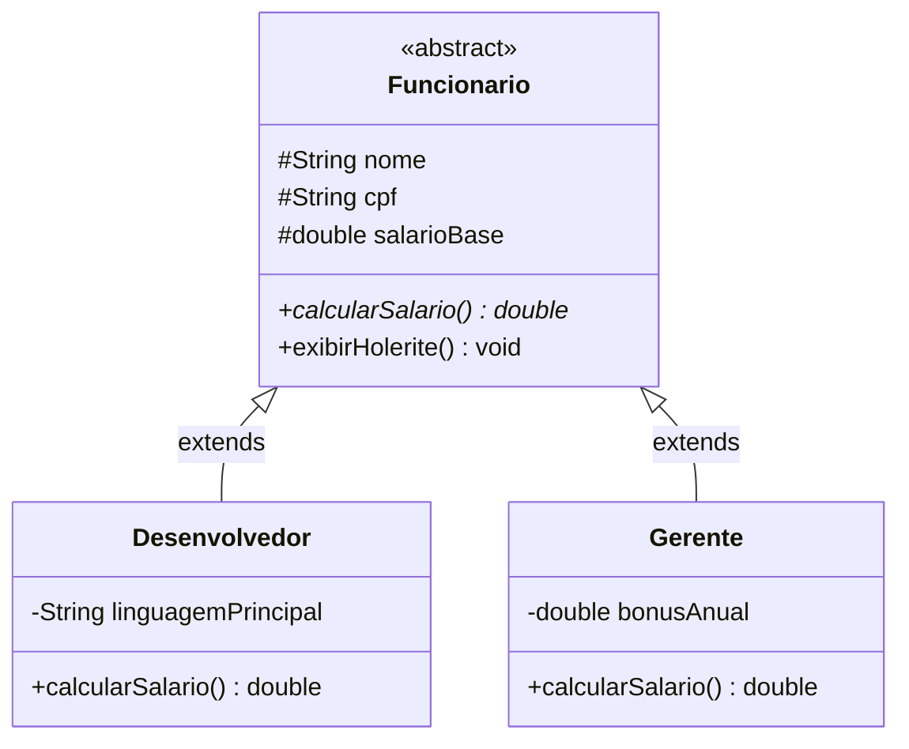

# 🧬 Aula 05: Herança, Classes Abstratas, Polimorfismo e o Modificador `final`

> *"A verdadeira força da Orientação a Objetos se revela quando o código aprende a tratar coisas diferentes de forma uniforme através do Polimorfismo."*

---

## 🎯 Objetivos de Aprendizagem
- Dominar o conceito de **Herança** (`extends`), relação "é um" e reaproveitamento estruturado.
- Utilizar a palavra-chave **`super`** para invocar construtores e métodos da superclasse.
- Compreender quando e por que declarar **Classes Abstratas** e **Métodos Abstratos** (`abstract`).
- Compreender o **Polimorfismo Dinâmico** e a execução em tempo de execução (*late binding*).
- Entender as três utilidades do modificador **`final`** (variáveis, métodos e classes).

---

## 👨‍👦 1. Herança (`extends` e `super`)

A herança estabelece uma relação de generalização e especialização: a classe filha herda todos os membros não privados da classe mãe.



### O papel de `super`:
- `super(nome, cpf, salarioBase)`: Deve ser a **primeira linha do construtor da subclasse** para repassar os valores que a superclasse precisa para inicializar.
- `super.exibirDados()`: Chama a versão original do método implementado na mãe antes ou depois da customização na filha.

---

## 🎭 2. Classes e Métodos Abstratos (`abstract`)

1. **Classe Abstrata (`public abstract class ...`):**
   - É um conceito genérico demais para existir sozinho no mundo real.
   - **NÃO PODE SER INSTANCIADA DIRETAMENTE COM `new`!**
   - `Funcionario f = new Funcionario();` -> ❌ ERRO DE COMPILAÇÃO!
   - Serve como superclasse base para outras herdarem.
2. **Método Abstrato (`public abstract double calcularSalario();`):**
   - Não possui corpo `{ ... }`, termina com ponto e vírgula `;`.
   - É um **contrato obrigatório**: toda subclasse concreta é obrigada a implementar a sua própria versão!

---

## 🪄 3. Polimorfismo Dinâmico: A Mágica do Back-End

Polimorfismo significa *"muitas formas"*. Em Java, isso significa que **uma variável do tipo da superclasse pode apontar para instâncias de qualquer uma de suas subclasses**:

```java
// Criamos uma lista genérica de Funcionários
List<Funcionario> equipe = new ArrayList<>();
equipe.add(new Desenvolvedor("Arthur", "123", 5000.0, "Java"));
equipe.add(new Gerente("Camila", "456", 9000.0, 3000.0));

// Iteramos polimorficamente!
for (Funcionario f : equipe) {
    // A JVM decide em tempo de execução qual calcularSalario() chamar!
    System.out.println(f.getNome() + " ganha R$ " + f.calcularSalario());
}
```

> 💡 **Benefício Supremo:**  
> Se amanhã criarmos uma nova classe `Designer extends Funcionario`, o código que calcula a folha de pagamento **não precisa ser alterado em uma única linha**! Isso é o Princípio Aberto/Fechado (*Open/Closed Principle* do SOLID).

---

## 🔒 4. O Modificador `final`

O modificador `final` representa imutabilidade ou encerramento da hierarquia:

| Onde aplicar? | O que significa? | Exemplo |
| :--- | :--- | :--- |
| **Em Variáveis / Atributos** | O valor não pode ser reatribuído (constante) | `public static final double PI = 3.14159;` |
| **Em Métodos** | O método **não pode ser sobrescrito** por subclasses | `public final void efetuarLogin() { ... }` |
| **Em Classes** | A classe **não pode ter filhas** (ninguém pode dar `extends`) | `public final class String { ... }` |
