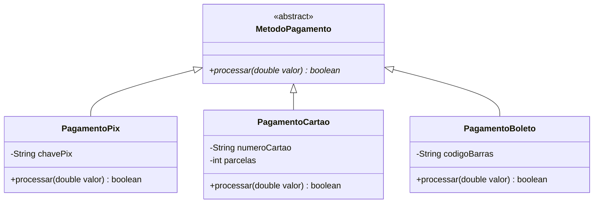

# 📝 Caderno de Exercícios & Desafios: Aula 05 (Herança & Polimorfismo)

Aprofunde seus conhecimentos sobre abstração, hierarquias de classes e desacoplamento polimórfico.

---

## 🎯 Exercício 01: Especialização de Contas Bancárias

### Cenário
Evolua o sistema bancário da Aula 02 criando uma hierarquia com herança:

1. Transforme a classe base `ContaBancaria` em uma classe abstrata com o método abstrato:
   ```java
   public abstract void aplicarAtualizacaoMensal();
   ```
2. Crie a subclasse `ContaCorrente`:
   - Possui atributo `limiteChequeEspecial` (double).
   - Na atualização mensal, desconta uma tarifa de manutenção de R$ 25,00.
3. Crie a subclasse `ContaPoupanca`:
   - Possui atributo `taxaRendimento` (ex: 0.005 para 0.5% ao mês).
   - Na atualização mensal, credita o rendimento sobre o saldo atual.
4. No `main`, armazene ambas em uma lista polimórfica e aplique a atualização mensal em um único laço `for`.

---

## 💳 Desafio Prático: Gateway de Pagamentos Polimórfico

### Cenário
Todo backend de e-commerce precisa suportar múltiplos métodos de pagamento sem que o código de checkout precise saber detalhes de cada um.



### Implementação do Gateway:
```java
public class CheckoutService {
    public void finalizarCompra(double valorTotal, MetodoPagamento metodo) {
        System.out.println("Iniciando transação no valor de R$ " + valorTotal);
        boolean sucesso = metodo.processar(valorTotal);
        if (sucesso) {
            System.out.println("Pedido confirmado e enviado para separação!");
        } else {
            System.out.println("Falha na operadora de pagamento. Tente novamente.");
        }
    }
}
```

---

## 🧠 Quiz de Fixação

1. **Podemos instanciar diretamente uma classe abstrata usando `new`?**
   - (A) Sim, desde que ela tenha construtor.
   - (B) Não, classes abstratas servem exclusivamente como modelos conceituais para herança. *(Correta)*
   - (C) Apenas se ela tiver métodos estáticos.

2. **O que acontece se uma subclasse concreta herdar de uma classe abstrata e esquecer de implementar um método abstrato?**
   - (A) O código compila normalmente e roda vazio.
   - (B) Ocorre um erro de compilação obrigando a implementação do método ou a declaração da própria subclasse como abstrata. *(Correta)*
   - (C) O método é apagado da memória.

3. **Para que serve o modificador `final` aplicado a uma classe?**
   - (A) Para indicar que ela foi a última classe criada no projeto.
   - (B) Para proibir que outras classes herdem dela (`extends`). *(Correta)*
   - (C) Para deletar a classe quando o programa fechar.

