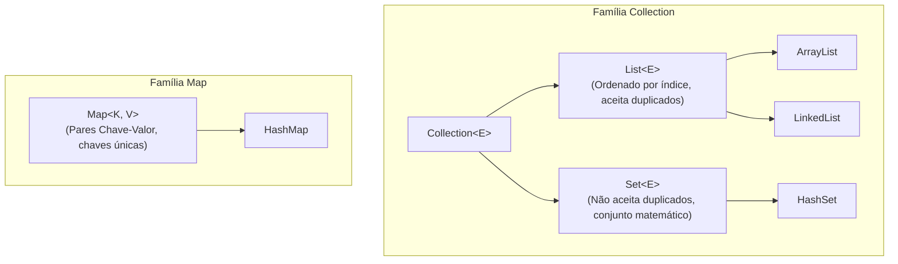

# 📚 Aula 06: Java Collections Framework e Generics

> *"Arrays estáticos pertencem ao passado: aplicações modernas de backend vivem e respiram sobre as estruturas dinâmicas do Collections Framework."*

---

## 🎯 Objetivos de Aprendizagem
- Entender por que arrays primitivos (`String[]`) são limitados e como o **Collections Framework** resolve isso.
- Dominar o uso de **Generics** (`<Tipo>`) para segurança de tipos em tempo de compilação.
- Compreender a diferença prática e computacional entre **`List`**, **`Set`** e **`Map`**.
- Comparar `ArrayList` vs `LinkedList` e `HashSet` vs `HashMap`.
- Aplicar os métodos essenciais de manipulação e iteração moderna de coleções.

---

## 🗺️ 1. O Mapa Mental do Collections Framework

O Java Collections Framework (localizado em `java.util`) organiza as coleções em duas grandes famílias:



---

## ⚖️ 2. Comparativo: Qual Coleção Escolher no Back-End?

| Estrutura | Aceita Duplicados? | Mantém Ordem de Inserção? | Acesso Rápido por... | Quando Usar no Back-End? |
| :--- | :--- | :--- | :--- | :--- |
| **`ArrayList<T>`** | Sim | Sim | Índice numérico (`get(i)`) | Listas de produtos, feed de postagens, retornos de consultas de banco de dados |
| **`HashSet<T>`** | **NÃO** | Não | Tabela Hash (`contains(obj)`) | Filtragem de duplicados, CPFs cadastrados, tags únicas, permissões de usuário |
| **`HashMap<K, V>`** | Valores Sim, **Chaves NÃO** | Não | Chave (`get(chave)`) | Dicionários, tabelas de cache em memória, busca de usuários por CPF/E-mail |

---

## 💎 3. Generics (`<T>`): Segurança de Tipos

Antes do Java 5, listas guardavam qualquer `Object`, o que causava temidos erros de `ClassCastException` em tempo de execução:

```java
// ❌ Modo Arcaico (Sem Generics)
List listaAntiga = new ArrayList();
listaAntiga.add("Arthur");
listaAntiga.add(100); // Aceitava misturar tudo!

// ✅ Modo Moderno com Generics
List<String> listaNomes = new ArrayList<>();
listaNomes.add("Arthur");
// listaNomes.add(100); // 🚫 O compilador barra imediatamente com erro!
```

---

## 🛠️ 4. Principais Métodos das Coleções

### Operações com `List`:
```java
List<String> cargos = new ArrayList<>();
cargos.add("Desenvolvedor Junior"); // Adiciona
cargos.add("Desenvolvedor Pleno");
cargos.add(0, "Estagiário");        // Adiciona em posição específica

String primeiro = cargos.get(0);    // Busca pelo índice
cargos.remove("Estagiário");        // Remove por valor
int total = cargos.size();          // Quantidade de elementos
boolean existe = cargos.contains("Desenvolvedor Pleno"); // Busca rápida
```

### Operações com `Set` (Eliminando Duplicatas):
```java
Set<String> tagsUnicas = new HashSet<>();
tagsUnicas.add("JAVA");
tagsUnicas.add("SPRING");
tagsUnicas.add("JAVA"); // ⚠️ Ignorado silenciosamente! Tamanho final: 2
```

### Operações com `Map` (Chave-Valor):
```java
Map<String, String> usuariosPorCpf = new HashMap<>();
usuariosPorCpf.put("111.222.333-44", "Arthur Silva");
usuariosPorCpf.put("555.666.777-88", "Beatriz Ramos");

String nomeEncontrado = usuariosPorCpf.get("111.222.333-44"); // Busca instantânea O(1)!
```

---

## 🔄 5. Iterações Modernas em Java

```java
// 1. Laço For-Each tradicional (claro e legível)
for (String cargo : cargos) {
    System.out.println("Cargo: " + cargo);
}

// 2. Iteração funcional com Lambda / Method Reference
cargos.forEach(System.out::println);
```

