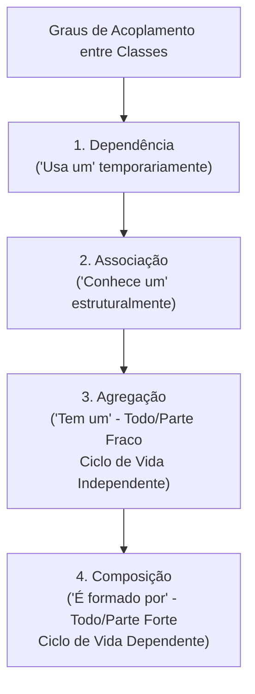
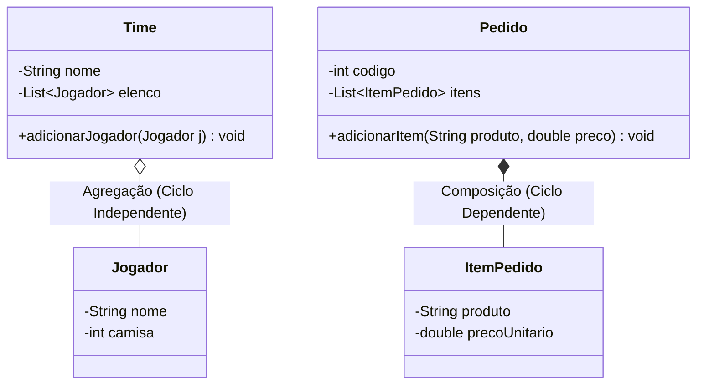

# 🔗 Aula 07: Relacionamentos entre Classes (Associação, Agregação e Composição)

> *"Nenhum objeto é uma ilha: o poder dos sistemas backend reside nas conexões e contratos estruturados entre diferentes entidades de negócio."*

---

## 🎯 Objetivos de Aprendizagem
- Diferenciar os 4 tipos fundamentais de relações: **Dependência**, **Associação Simples**, **Agregação** e **Composição**.
- Compreender o conceito de **Ciclo de Vida Dependente vs. Independente**.
- Interpretar e desenhar a notação gráfica oficial em diagramas de classe **UML** (losangos e multiplicidades).
- Modelar relacionamentos de cardinalidade **1 para 1**, **1 para N** e **N para N** em código Java puro.

---

## 📐 1. Os 4 Graus de Relacionamento em POO

---

## ⚖️ 2. Agregação vs. Composição: O Grande Duelo Conceitual

Essa é a pergunta clássica de entrevistas de emprego para desenvolvedores Java backend:

| Critério | Agregação (Todo-Parte Fraco) ⚪ | Composição (Todo-Parte Forte) ⚫ |
| :--- | :--- | :--- |
| **Símbolo UML** | Losango **Vazado** (transparente) `o--` | Losango **Preenchido** (sólido) `*--` |
| **Ciclo de Vida** | **Independente**: se o Todo for destruído, a Parte continua existindo! | **Dependente**: a Parte só existe enquanto o Todo existir; se o Todo morrer, a Parte é eliminada junto! |
| **Exemplo Real** | `Time` e `Jogador`: Se o time falir, os jogadores continuam existindo e vão para outros clubes. | `Pedido` e `ItemPedido`: Se cancelarmos e apagarmos o Pedido, os itens daquele pedido deixam de ter razão de existir! |
| **Criação do Objeto** | O objeto parte é passado de fora via parâmetro ou construtor. | O objeto parte costuma ser instanciado dentro do próprio Todo. |

---

## 🔢 3. Cardinalidades e Multiplicidades

A cardinalidade define quantos objetos de um lado podem se relacionar com quantos objetos do outro lado:

1. **Um para Um (1 : 1):**  
   - Exemplo: Cada `Usuario` possui exatamente 1 `PerfilDeAcesso`.
   - Em Java: `Usuario` tem um atributo `private PerfilDeAcesso perfil;`.
2. **Um para Muitos (1 : N):**  
   - Exemplo: Um `Departamento` possui vários `Funcionarios`.
   - Em Java: `Departamento` tem um atributo `private List<Funcionario> funcionarios;`.
3. **Muitos para Muitos (N : N):**  
   - Exemplo: Um `Aluno` cursa várias `Disciplinas`, e uma `Disciplina` possui vários `Alunos`.
   - Em Java: Ambos possuem listas mútuas (`List<Disciplina>` no Aluno e `List<Aluno>` na Disciplina).
