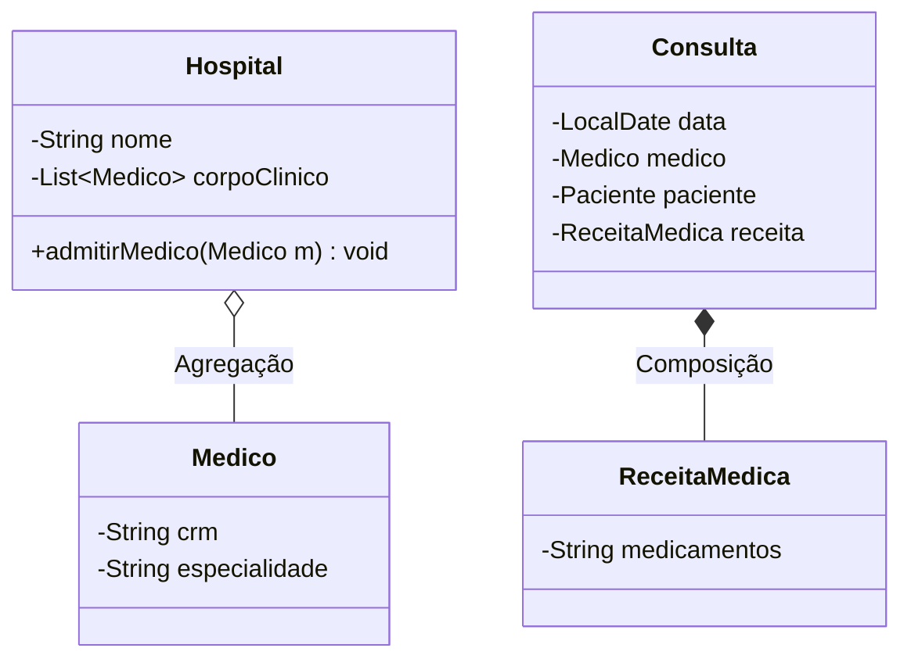

# 📝 Caderno de Exercícios & Desafios: Aula 07 (Relacionamento entre Classes)

Pratique o desenho arquitetural e a implementação de relacionamentos estruturados entre entidades.

---

## 🎯 Exercício 01: O Dilema do Veículo: Agregação ou Composição?

### Cenário
Analise os seguintes componentes de um `Carro`:
1. **Motor:** Pode um motor existir fora de um carro (em uma bancada de testes ou oficina)? Sim!
2. **Chassi:** A numeração gravada na estrutura do carro pode ser transferida para outro veículo mantendo a mesma identidade jurídica? Não!
3. **Pneus:** Podem ser trocados, vendidos usados e instalados em outro carro? Sim!

### Tarefa:
Classifique a relação entre `Carro` e cada componente:
- `Carro` e `Motor`: Agregação.
- `Carro` e `Chassi`: Composição.
- `Carro` e `Pneus`: Agregação.

---

## 🏢 Desafio Prático: Modelagem de Sistema Hospitalar

Modele em Java e Mermaid as classes para um Hospital:
1. Um `Hospital` possui vários `Medicos` (Agregação - se o hospital fechar, os médicos continuam exercendo sua profissão).
2. Uma `Consulta` possui 1 `Medico`, 1 `Paciente` e um `Prontuario` (Composição - o prontuário daquela consulta específica morre com a consulta).

---

## 🧠 Quiz de Fixação

1. **Qual a principal diferença entre Agregação e Composição?**
   - (A) Na agregação as partes são independentes do todo; na composição, as partes têm ciclo de vida dependente do todo e são destruídas com ele. *(Correta)*
   - (B) Agregação é em Java e Composição é em C#.
   - (C) Não existe diferença técnica, apenas semântica.

2. **Como a Composição é representada na notação oficial UML?**
   - (A) Por uma seta pontilhada.
   - (B) Por um losango preenchido (sólido/preto) ligado à classe Todo. *(Correta)*
   - (C) Por um círculo vermelho.

3. **Quando uma classe apenas recebe outra como parâmetro temporário de um método e não a armazena em nenhum atributo, que relacionamento ocorre?**
   - (A) Herança múltipla.
   - (B) Dependência. *(Correta)*
   - (C) Composição reflexiva.

