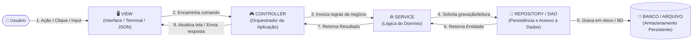

# 🏛️ Aula 08: Arquitetura MVC, Separação de Camadas e Persistência de Dados

> *"Código misturado é código morto: o padrão MVC e a arquitetura em camadas organizam a responsabilidade de cada linha do seu backend."*

---

## 🎯 Objetivos de Aprendizagem
- Entender a motivação arquitetural do padrão **MVC** (*Model - View - Controller*).
- Desconstruir o *Model* corporativo em: **Entity**, **Service** e **Repository / DAO**.
- Compreender a persistência de dados em arquivos e a transição para bancos de dados com **JPA / Hibernate** (ORM).
- Mapear o fluxo de uma requisição ponta a ponta (do clique do usuário até a gravação em disco).
- Reconhecer *Anti-Patterns* comuns (como *Fat Controller* e regras de negócio na View).

---

## 🏗️ 1. O Padrão Arquitetural MVC

O MVC nasceu para resolver o pesadelo do código espaguete, onde comandos SQL, cálculos de juros e botões gráficos ficavam amontoados na mesma classe:

---

## 🧩 2. As Camadas do Back-End Corporativo

| Camada | Função Principal | O que DEVE ter? | O que NUNCA deve ter? |
| :--- | :--- | :--- | :--- |
| **View** | Interagir com o usuário (exibir dados e receber comandos) | `System.out.println()`, inputs, formatação de tela | Cálculos de juros, queries SQL, validações de negócio |
| **Controller** | Receber requisições e coordenar a execução | Validação de formatos básicos, chamadas a serviços | Lógica pesada de negócio ou acesso direto a arquivos/BD |
| **Service** | O coração da aplicação: regras de negócio | Cálculos, taxas, checagens de integridade, regras | Códigos de interface gráfica ou comandos SQL manuais |
| **Repository (DAO)** | Isolar a persistência | `salvar()`, `buscarPorId()`, `listar()`, leitura/escrita em arquivos | Telas, diálogos ou regras de negócio |
| **Entity (Model)** | A representação do dado no sistema | Atributos privados, getters/setters, construtores | Nenhuma lógica pesada ou conexão de banco |

---

## 💾 3. Persistência de Dados e ORM

Em aplicações reais, quando o programa é encerrado, todos os objetos na memória RAM desaparecem. Para manter os dados vivos, precisamos de **Persistência**:
1. **Persistência em Arquivos Locais (`java.nio.file` / `FileWriter`):**  
   Ideal para arquivos de configuração, logs e pequenos sistemas desktop simples.
2. **Bancos de Dados Relacionais (SQL):**  
   Tabelas em PostgreSQL, MySQL, H2 com colunas e chaves estrangeiras.
3. **ORM (Mapeamento Objeto-Relacional com JPA/Hibernate):**  
   Traduz automaticamente objetos Java (`Usuario`) em linhas de tabelas SQL (`tb_usuarios`) sem que o programador precise escrever dezenas de `INSERT` manuais.

---

## 🚫 4. Principais Anti-Patterns para Evitar
- **Fat Controller (Controller Gordo):** Colocar regras de negócio, cálculos e conexão com banco direto no Controller.
- **Vazamento de Abstração:** Fazer a View falar diretamente com o Banco de Dados pulando o Service.
- **God Class:** Uma única classe gigante de 3.000 linhas fazendo tudo no projeto.
