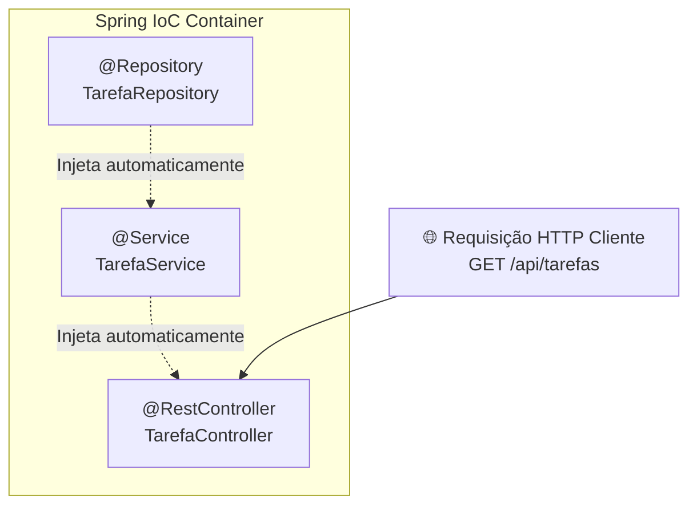

# 🚀 Aula 09: O Ecossistema Spring, Spring Boot e APIs RESTful

> *"O Spring Boot é o padrão da indústria para o desenvolvimento corporativo em Java: ele automatiza a infraestrutura para você focar no que gera valor: as regras de negócio."*

---

## 🎯 Objetivos de Aprendizagem
- Entender o que é o **Spring Framework** e como o **Spring Boot** revolucionou a produtividade com convenção sobre configuração.
- Dominar os conceitos de **Inversão de Controle (IoC)** e **Injeção de Dependências (DI)**.
- Compreender a arquitetura e os padrões de uma **API RESTful** com protocolo HTTP e JSON.
- Aprender as anotações centrais do Spring: `@RestController`, `@RequestMapping`, `@GetMapping`, `@PostMapping`, `@RequestBody`, `@PathVariable` e `ResponseEntity`.
- Estruturar um projeto profissional em camadas conectado a banco de dados com **Spring Data JPA** e **H2**.

---

## 🍃 1. Spring Framework vs. Spring Boot

| Aspecto | Spring Framework Tradicional | Spring Boot Moderno |
| :--- | :--- | :--- |
| **Configuração** | Arquivos XML pesados e complexos | Zero XML, configuração automática via anotações |
| **Servidor Web** | Precisava instalar Tomcat/WildFly separado no SO | Servidor Tomcat embutido dentro do `.jar` executável |
| **Dependências** | Gerenciar dezenas de versões compatíveis manualmente | Spring Boot Starters (`spring-boot-starter-web`) |
| **Tempo para o primeiro 'Hello World'**| Horas ou dias de setup | Menos de 5 minutos! |

---

## 🔄 2. Inversão de Controle (IoC) e Injeção de Dependência (DI)

No Java tradicional, quem precisa de um serviço dá `new`:
```java
// Acoplamento forte manual:
TarefaService service = new TarefaService(new TarefaRepository());
```

Com o **Spring Boot**, você nunca mais dá `new` nos seus serviços!  
O **Container IoC do Spring** descobre suas classes via anotações, instancia cada uma delas como um **Bean** único (*Singleton*) e as injeta automaticamente onde for necessário:



---

## 🌐 3. Anatomia de uma API RESTful

REST é um estilo de arquitetura para comunicação entre sistemas usando o protocolo HTTP e dados em formato **JSON**:

### Verbos HTTP e Operações CRUD:
| Operação CRUD | Verbo HTTP | Anotação Spring | Exemplo de Rota | Status HTTP Ideal |
| :--- | :--- | :--- | :--- | :--- |
| **Create (Criar)** | `POST` | `@PostMapping` | `/api/tarefas` | `201 Created` |
| **Read (Ler)** | `GET` | `@GetMapping` | `/api/tarefas` ou `/{id}` | `200 OK` |
| **Update (Atualizar)** | `PUT` | `@PutMapping` | `/api/tarefas/{id}` | `200 OK` |
| **Delete (Remover)** | `DELETE` | `@DeleteMapping` | `/api/tarefas/{id}` | `204 No Content` |

### Principais Códigos de Status HTTP:
- `200 OK`: Requisição processada com sucesso.
- `201 Created`: Novo recurso cadastrado com sucesso.
- `204 No Content`: Ação realizada com sucesso, sem corpo de retorno (comum em delete).
- `400 Bad Request`: Dados inválidos enviados pelo cliente.
- `404 Not Found`: Recurso/ID não encontrado.
- `500 Internal Server Error`: Falha inesperada no servidor.

---

## 📝 4. Exemplo de Controller REST no Spring Boot

```java
@RestController
@RequestMapping("/api/tarefas")
public class TarefaController {

    private final TarefaService service;

    // Injeção de dependência elegante via construtor
    public TarefaController(TarefaService service) {
        this.service = service;
    }

    @GetMapping
    public ResponseEntity<List<Tarefa>> listarTodas() {
        return ResponseEntity.ok(service.listarTodas());
    }

    @PostMapping
    public ResponseEntity<Tarefa> criar(@RequestBody TarefaDTO dto) {
        Tarefa salva = service.salvar(dto);
        return ResponseEntity.status(HttpStatus.CREATED).body(salva);
    }
}
```
